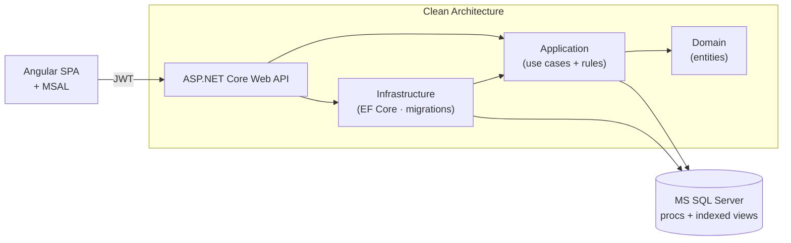

# FinTrack — Enterprise Banking Operations Portal

   

A role-based banking operations portal built **end to end with the Microsoft stack**:
an Angular SPA consuming an ASP.NET Core Web API over a business layer arranged with
**Clean Architecture**, an **MS SQL Server** data tier (tables, stored procedures, indexed views),
**Azure AD B2C single sign-on**, and a **CI/CD pipeline with staging-slot deployments**.

> Built as a portfolio project to demonstrate the shapes a fintech employer expects you to
> own: layered .NET services, EF Core code-first migrations, SPA + API contract discipline,
> and a pipeline that deploys with staging slots.

---

## ✨ Feature highlights (mapped to the stack)

| Capability | Where to look |
| --- | --- |
| 🔁 **Money transfer with atomic ledger** | `src/FinTrack.Application/Accounts/TransferService.cs` — limits, ownership, currency checks; paired ledger entries inside one transaction; optimistic concurrency (rowversion) → `409 CONCURRENT_UPDATE` |
| 🧾 **Business-rule codes end to end** | stable codes (`INSUFFICIENT_FUNDS`, `EXCEEDS_DAILY_LIMIT`, …) → `THROW 50xxx` in procs ↔ ProblemDetails ↔ Angular error copy |
| 🧠 **Server-side money rules too** | `database/02_stored_procedures.sql` (`usp_PostTransfer` with `UPDLOCK`) — same invariants for batch loads |
| 📊 **Indexed views** | `database/03_indexed_views.sql` — daily roll-ups materialized for dashboards |
| 🔐 **Azure AD B2C SSO + RBAC** | `Auth:Mode` env switch: production B2C validation, plus a local JWT stub so the stack demos offline; resource-based authorization handler |
| ⚡ **EF Core code-first** | model `FinTrackEntityConfigurations` + committed baseline migration applied on startup |
| 🏗️ **CI/CD with slots** | `pipelines/ci.yml` (build+test+artifacts), `pipelines/cd.yml` (staging slot deploy → smoke `/health` → approval → swap) |
| ✅ **xUnit suite** | business-rule matrix, paging, and full API contract tests via `WebApplicationFactory` |

## Architecture



Full detail: [`docs/architecture.md`](docs/architecture.md) · Database design: [`docs/database.md`](docs/database.md) · Security: [`docs/security.md`](docs/security.md)

## Project structure

```
FinTrack/
├── FinTrack.sln
├── src/
│   ├── FinTrack.Domain/            # entities + enums (no framework deps)
│   ├── FinTrack.Application/       # use cases, contracts, exceptions, paging
│   ├── FinTrack.Infrastructure/    # EF Core DbContext, migrations, initializer, auth glue
│   ├── FinTrack.Api/               # controllers, JWT config, ProblemDetails middleware
│   └── FinTrack.Tests/             # xUnit: rule matrix + WebApplicationFactory contract tests
├── webapp/                            # Angular 17 SPA (standalone components)
├── database/                          # SQL scripts (01 tables · 02 procs · 03 indexed views · 04 demo seed)
├── docs/                              # architecture, database, security
└── pipelines/                         # CI + CD definitions (slots)
```

## Quickstart (runs with zero external dependencies)

```bash
# 1. API — defaults to a disposable SQLite database + seeded demo data
cd src/FinTrack.Api
dotnet run                          # → http://localhost:5000  (Swagger at /swagger)

# 2. Angular UI
cd webapp
npm install
npm start                           # → http://localhost:4200  (proxies /api → :5000)
```

**Demo logins** (development identity stub, `Auth:Mode=Development`):
`admin` · `teller` · `amira` (customer) · `tarek` (customer) — the UI login screen posts
to `POST /api/auth/token`. Point `Auth:Mode=AzureAdB2C` at your tenant section to switch on real SSO.

**MS SQL Server:** set `Database:Provider=SqlServer`, adjust connection string `SqlServer`,
run migrations (applied at startup), then execute `database/02_stored_procedures.sql`,
`03_indexed_views.sql`, and `04_seed_demo.sql` for the demo dataset.

## API surface (abbreviated)

| Method | Route | Who | Purpose |
| --- | --- | --- | --- |
| POST | `/api/auth/token` | dev only | development JWT (stub) |
| GET | `/api/accounts?customerId=` | owner or staff | account summaries |
| POST | `/api/accounts` | staff | open account |
| POST | `/api/accounts/{id}/close` | staff | close zero-balanced account |
| GET | `/api/accounts/{id}/transactions?page=&pageSize=` | owner or staff | paged ledger |
| POST | `/api/transfers` | owner or staff | atomic transfer |
| GET | `/api/customers` / `/api/customers/{id}` | staff / owner | directory + profile |
| GET | `/health` | anonymous | readiness probes |

Full request/response shapes + error codes: Swagger UI (`/swagger`).

## Testing

```bash
dotnet test FinTrack.sln
```

- **Rule matrix** (`TransferServiceTests`, `AccountServiceTests`) — 15+ cases: limits, ownership,
  statuses, currency mismatch, insufficient funds, daily cap window, paging, closed-account hygiene.
- **API contract tests** (`ApiContractTests`) — authn/authz (401/403), transfer + ledger assertions,
  ProblemDetails codes — all through the real pipeline (routing, model binding, middleware).

## Deployment

- CI: `pipelines/ci.yml` — restore/build/test/publish artifacts for API + Angular.
- CD: `pipelines/cd.yml` — Web API → **staging slot** → `/health` smoke → approval gate → **slot
  swap** to production (instant rollback by re-swapping). Angular bundle deploys as static content
  via the same slot model (documented in `docs/architecture.md`).
- Environment provisioning checklist — `docs/security.md` § Operational checklist.

## Roadmap

- [ ] Statement PDF export (pdf generation + Blob ephemeral links)
- [ ] Interest accrual job (Savings) with posting journal lock
- [ ] Per-request idempotency keys on transfers
- [ ] OpenTelemetry traces across API → SQL

## License

MIT — see [LICENSE](LICENSE).
