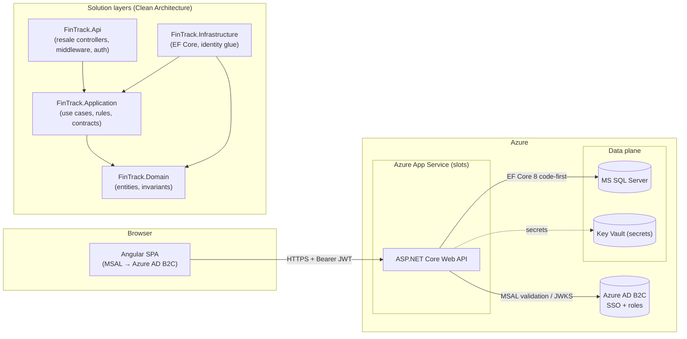

# FinTrack — Architecture

## System overview

## Dependency rule

- **Domain** — pure entities and enums; no framework references.
- **Application** — use cases, business-rule exceptions, DTOs, persistence abstractions
  (`IApplicationDbContext`, `ITransactionScope`, `ICurrentUser`, `IDateTime`). References EF Core's
  *core* API only (for LINQ/DbSets); it never references a database provider.
- **Infrastructure** — `FinTrackDbContext` (SQL Server / SQLite demo), migrations, identity and clock
  adapters, database initializer + demo seeding.
- **Api** — controllers, ProblemDetails middleware, JWT configuration, Swagger, health checks.

Credit: layering follows the Community-Clean-Architecture conventions (Jason Taylor template style).

## Transfer flow (dual implementation)

The same invariants are enforced in two places on purpose:

1. **Application layer** (`TransferService`) — used by the API in real time; guards limits,
   ownership, currency, balance; writes a paired ledger under a transaction; Account rowversion
   covers the check/act window with optimistic concurrency.
2. **Database layer** (`dbo.usp_PostTransfer`) — used by batch loads and as defense against
   direct SQL callers; `UPDLOCK/HOLDLOCK` serializes read-modify-write; `THROW 50xxx` codes map
   1:1 to the API's stable business codes (see `database/02_stored_procedures.sql`).

Migration path backstory: stored procedures remain for high-frequency HOT paths and drive the
key indexing decisions documented in `docs/database.md`.

## Key decisions

| Decision | Why |
| --- | --- |
| GUID keys (`NEWID()`)-friendly | PII-agnostic, merge-friendly, no leaking sequences; clustered PK + separate true order column |
| Ledger is append-only | Balance is always reconcilable with its history (auditor-friendly) |
| Rowversion on Account | Optimistic concurrency → no lost balance updates; race cases handled via 409 CONCURRENT_UPDATE |
| Indexed view for daily totals | Dashboard charts read pre-aggregated stable storage instead of aggregating hot tables |
| Stable business codes over raw HTTP semantics | Client keys off `code` to show actionable copy; codes match THROW and service |
| Auth:Modeenv switch | AzureAdB2C in prod; HS256 dev issuer locally so the full stack runs anywhere |

## Testing strategy

- **Unit (xUnit)** — rule matrix for transfers/accounts on EF InMemory (deterministic clock).
- **Contract (xUnit, WebApplicationFactory)** — routing + auth + ProblemDetails through the real
  pipeline; exercises the dev token issuer and role policies end to end.
- **Database** — scripts vs. migrations cross-checked; procs mirror service codes.
- **CI/CD** — pipeline runs tests on every push; CD deploys via staging slots with a swap.
